# Practice apps: which app to run through the template, in what order

The [template](template/README.md) is generic, so it needs a real app to run
through. **No single app teaches everything**, so this is a ladder: each app is
chosen for what it adds that the earlier ones didn't. Do them in order. Every
step reuses the platform you already built and adds one new kind of difficulty.

> Status checked on 2026-10-12 (GitHub: archived or not, last push). Re-check
> before you start a step; demo apps go stale.

```mermaid
flowchart LR
    A["1 · Podinfo<br/><i>platform smoke test</i>"] --> B["2 · AWS Retail Store<br/><b>main project</b><br/>P0 → P11"]
    B --> C["3 · Online Boutique<br/><i>second app, prove it transfers</i>"]
    C --> D["4 · OpenTelemetry Demo<br/><i>observability practice</i>"]
    D --> E["5 · Bank of Anthos<br/><i>security focus</i>"]
    E --> F["6 · TeaStore<br/><i>first diagnosis drill</i>"]
    F --> G["7 · Train-Ticket<br/>+ fault-replicate<br/><b>final hard mode</b>"]

    classDef main fill:#dbeafe,stroke:#2563eb,color:#172554
    classDef hard fill:#fee2e2,stroke:#dc2626,color:#450a0a
    classDef mid fill:#dcfce7,stroke:#16a34a,color:#052e16
    class A,B main
    class C,D,E mid
    class F,G hard
```

| # | App | What it adds | Template phases | Size and cost | Status |
|---|---|---|---|---|---|
| 1 | [Podinfo](https://github.com/stefanprodan/podinfo) | Proves the platform before your real app touches it | P4, P8, P9, P8-8 | 1 service; tiny | Maintained |
| 2 | [AWS Retail Store](https://github.com/aws-containers/retail-store-sample-app) | The full end-to-end run: polyglot, stateful, async, AWS-native backends | **All, P0 → P11** | 5 services; small | Maintained (AWS) |
| 3 | [Online Boutique](https://github.com/GoogleCloudPlatform/microservices-demo) | A different shape: 11 services, 5 languages, gRPC | P2, P3, P6, P7, P8 | 11 services; medium | Maintained (Google) |
| 4 | [OpenTelemetry Demo](https://github.com/open-telemetry/opentelemetry-demo) | Rich telemetry and **switchable failure scenarios** | P10 | 15+ services, Kafka; heavy, so one session at a time | Maintained (CNCF) |
| 5 | [Bank of Anthos](https://github.com/GoogleCloudPlatform/bank-of-anthos) | Login, JWTs, money movement: a security-first app | P5, P8, P8-11, P9 | 6 services + 2 Postgres; medium | Maintained (Google) |
| 6 | [TeaStore](https://github.com/DescartesResearch/TeaStore) | A small research benchmark: inject a fault, find it from traces | P10-8, P10-12 | 5 services + a registry; small | Slow (last push Jan 2025) |
| 7 | [Train-Ticket](https://github.com/FudanSELab/train-ticket) + [fault-replicate](https://github.com/FudanSELab/train-ticket-fault-replicate) | **Final hard mode:** 22 real industry failures to diagnose in 41 services | P10-12 | 41 services; **≥ 24 GB RAM**; expensive | Slow (last push Nov 2025) |

**Avoid:**
- **Sock Shop** and **Robot Shop**: archived upstream. Sock Shop stays the template's worked example in the text only.
- **PiggyMetrics**: dormant since 2024.
- **Microsoft eShop**: built around .NET Aspire, not plain Kubernetes.
- **Voting App and PetClinic**: too small to exercise the template.

---

## 1. Podinfo: platform smoke test

> **Every app on this ladder is open source:** fork it, clone your fork, and make the fork safe (Actions off, read-only token) before the first push. See [P1-0](template/01-dev-environment.md#p1-0-get-the-code-clone-fork-or-both).

**Why first:** one tiny Go service built *for testing Kubernetes platforms*.
It has health and readiness endpoints, Prometheus metrics, a version you can
bump, and it's designed for canary releases. If something breaks here, the
problem is your platform, not the app.

**When:** right after the EKS cluster exists in run 2, before the Retail Store
is deployed there. Not a separate project; one or two sessions.

**Alternative track: a full P0 → P11 run on Podinfo first.** It's the cheapest
way to learn every phase once on an app small enough to read line by line,
before taking on Retail Store's polyglot, stateful shape. Write it down as an
ADR (application choice, P0-8). Also list the lessons it *can't* teach (slow
start / `startupProbe`, a real datastore, connection pooling, multi-service
NetworkPolicy) so Retail Store covers them. Build your own image in P2 instead
of mirroring upstream's. Owning the build also lets you patch what the
platform needs (e.g. turning off `/env` and `/configs`, see P5-5).

- [ ] Deploy it through Argo CD (P8-3) from the gitops repo: the first app the platform ever syncs
- [ ] Expose it with a `Gateway` + `HTTPRoute` on the ALB, with ACM TLS and an ExternalDNS record (P9)
- [ ] Kyverno admits it only when signed and pinned by digest (P8-6). Mirror its image into your ECR and sign it with Cosign
- [ ] Canary with Argo Rollouts (P8-8): bump the version → watch the traffic split → push a bad version → watch the automatic rollback
- [ ] **Done when:** `https://podinfo.<your-domain>` serves over TLS, a manual `kubectl` change gets reverted, and a bad canary rolls itself back

---

## 2. AWS Retail Store: the main project (P0 → P11)

**Why:** made by AWS "for educational purposes", maintained, and built for EKS.

| Component | Language | Backends you can choose |
|---|---|---|
| UI | Java | — |
| Catalog | Go | MariaDB/MySQL (in-cluster, or RDS) |
| Cart | Java | MongoDB, or DynamoDB |
| Orders | Java | PostgreSQL; events to RabbitMQ **or** SQS |
| Checkout | Node | Redis (in-cluster, or ElastiCache) |

It also ships Prometheus metrics, OpenTelemetry tracing, a load generator,
Compose, Helm charts and multi-arch images.

**How to run it through the template:**

- [ ] **P0:** inventory the 5 services, the backends and the CUJ (browse → add to cart → checkout)
- [ ] **P2:** write **your own** Dockerfiles from source (don't reuse the published images), then compare yours to theirs
- [ ] **P3:** on KinD, with every backend in-cluster: MariaDB, MongoDB, Postgres, Redis, RabbitMQ
- [ ] **P4-9:** switch the backends to managed services one at a time: RDS, DynamoDB, ElastiCache, SQS. Each switch is a small ADR
- [ ] **P5:** Pod Identity per service. Cart gets DynamoDB access on its own table only; Orders gets SQS on its own queue only; negative tests across services
- [ ] **P6–P10:** as written; use its load generator for P6-2 and P10-7
- [ ] **P11:** write it up. This is your portfolio project
- [ ] **Template feedback:** wherever a step only works for Sock Shop, fix the template and note it. This run is also the template's test

**Done when:** every phase's "Prove it" passes for this app.

---

## 3. Online Boutique: prove it transfers

**Why:** a different shape. There are 11 services in Go, C#, Node, Python and
Java, talking over **gRPC** instead of REST. Rebuilding the platform for a
second app shows whether you *learned* the template or *memorised* one app.

- [ ] Reuse the platform repo and the pipeline; only the app and gitops repos are new
- [ ] **P2:** five language toolchains → five Dockerfile patterns
- [ ] **P3/P9:** gRPC health probes (`grpc:` probes) and gRPC through the Gateway
- [ ] **P6:** right-size 11 services from measured usage (P2-9); HPA under its built-in Locust load generator
- [ ] **P7:** a matrix pipeline that only rebuilds changed services
- [ ] Skip the Google Cloud extras (Spanner, AlloyDB, Memorystore). Use in-cluster Redis or ElastiCache instead
- [ ] **Done when:** the same template phases pass with no new template steps needed. Any step you had to invent is a template gap

---

## 4. OpenTelemetry Demo: observability practice

**Why:** the reference app for logs, metrics and traces. It has more than 15
services (including Kafka, Postgres and Valkey), all instrumented with
OpenTelemetry. Most importantly, it has **built-in failure scenarios switched
on with feature flags** (flagd), so you can break it on purpose and practise
finding out why.

- [ ] Run it for **one session at a time**: it needs several GB of RAM, so destroy it afterwards
- [ ] Point its collector at your P10 backend (AMP, CloudWatch, X-Ray) **or** your local LGTM stack from P3-10. The same instrumentation works with either: that's the OpenTelemetry lesson
- [ ] SLOs and burn-rate alerts on its checkout flow (P10-4)
- [ ] Turn on one failure flag at a time. For each: did an alert fire? Can you get from the alert to the trace to the log line? Write a post-mortem (P10-8)
- [ ] **Done when:** you've diagnosed 3 flag-injected failures from telemetry alone, before reading what each flag does

---

## 5. Bank of Anthos: security focus

**Why:** a banking app with user login (JWTs), two Postgres databases and money
transfers. It turns the template's security phases from "the scanner passed"
into "this protects someone's money".

- [ ] Replace the Google Cloud parts (Cloud SQL, GCP workload identity) with RDS Postgres and Pod Identity
- [ ] **P5:** the JWT signing key in Secrets Manager via ESO; key rotation drill
- [ ] **P8-11:** service mesh with mTLS; authorization policy: only the three ledger services (`ledgerwriter`, `balancereader`, `transactionhistory`) may reach `ledger-db`. Negative test: `frontend` and a debug pod are denied
- [ ] **P9-6:** WAF rate-limit on `/login`; brute-force test gets blocked
- [ ] **P10-6:** an authenticated ZAP scan (logged in as a test user)
- [ ] **Done when:** a threat model (P0-9) for a bank exists, and each of its top 3 risks has a control with a passing negative test

---

## 6. TeaStore: first diagnosis drill

**Why:** a small research benchmark from the University of Würzburg (5 Java
services + a service registry, MySQL). It's a gentle introduction to
"something is wrong; find it from telemetry", before the much bigger final
step. This is the first half of P10-12.

- [ ] Deploy it, wire up OpenTelemetry tracing
- [ ] Someone else (or a script with a hidden choice) injects one fault: latency on one service, a killed DB connection, a CPU hog
- [ ] Find it from traces and metrics only; record the time to diagnosis
- [ ] **Done when:** you name the faulty service and the cause before looking at what was injected

---

## 7. Train-Ticket + fault-replicate: final hard mode

**Why:** Fudan University's Software Engineering Lab built Train-Ticket as a
**research benchmark** for microservice faults, and academic papers use it to
test root-cause analysis. Its companion repo
[train-ticket-fault-replicate](https://github.com/FudanSELab/train-ticket-fault-replicate)
contains **22 failures reproduced from real industry incidents**. This is the
second half of P10-12 and the hardest thing in the whole path.

**Size warning:**
- 41 services: Java Spring Cloud, plus Node, Python and Go, with MongoDB and MySQL
- Its own guide asks for **at least 24 GB of RAM and 50 GB of disk** for Docker Compose
- Each service needs roughly 0.2–1 CPU and 200 MB–1 GB of RAM
- On EKS that means several large nodes. Run it in short sessions, Spot nodes via Karpenter, and destroy immediately after

**How:**

- [ ] Deploy the base system with tracing (`make deploy DeployArgs="--with-tracing --with-monitoring"`), or wire it into your own P10 stack
- [ ] Pick faults from fault-replicate **without reading their write-ups**. Start with:
  - **F1:** an async ordering race
  - **F3:** a JVM memory limit set above the container's cgroup limit (the `MaxRAMPercentage` lesson from P2-2)
  - **F5:** one service's thread-pool exhaustion cascading into others
- [ ] For each: alert → trace → root cause → fix → post-mortem (P10-8), with time to diagnosis recorded
- [ ] Only then read the fault's write-up and compare it with your diagnosis
- [ ] **Done when:** you've diagnosed 3 faults unaided. Each one becomes an interview story (P11-5)

---

## Rough effort

| # | App | Part-time effort |
|---|---|---|
| 1 | Podinfo | 1–2 sessions, inside run 2 |
| 2 | Retail Store | the full template: about 3 months |
| 3 | Online Boutique | 3–5 weeks (the platform already exists) |
| 4 | OpenTelemetry Demo | 1–2 weeks |
| 5 | Bank of Anthos | 2–3 weeks |
| 6 | TeaStore | a few sessions |
| 7 | Train-Ticket | 2–4 weeks, in short, expensive sessions |

Steps 3–5 can be reordered by interest. Keep 1 → 2 first and 6 → 7 last.

## Sources

- Status: GitHub API, checked 2026-10-12
- Retail Store components and backends: its [README](https://github.com/aws-containers/retail-store-sample-app) and `src/orders/README.md`
- Train-Ticket size: its [installation guide](https://github.com/FudanSELab/train-ticket/wiki/Installation-Guide)
- Train-Ticket per-service resources: [BARO paper](https://arxiv.org/pdf/2405.09330)
