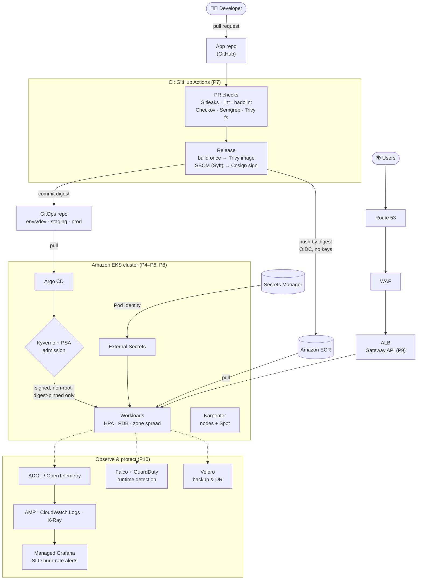
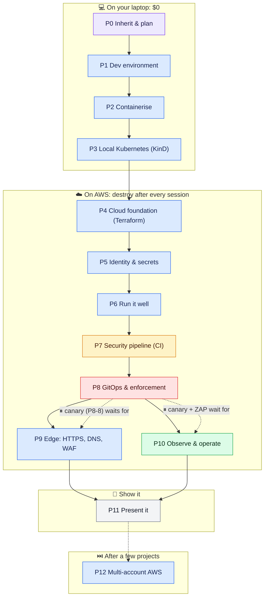
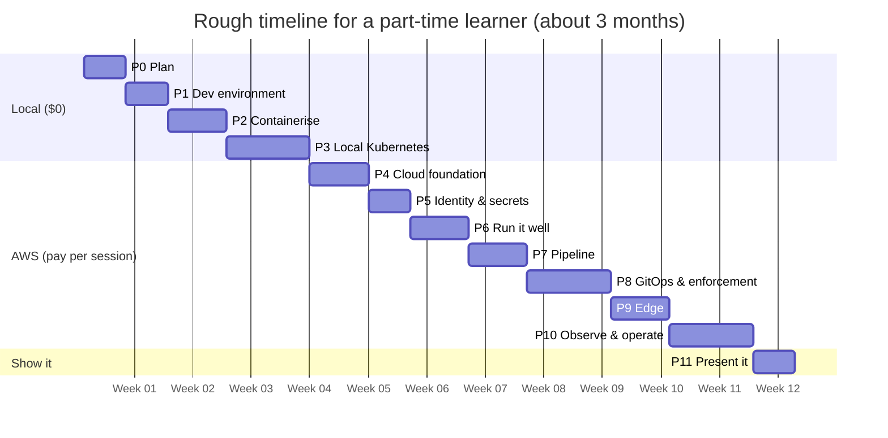
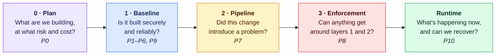
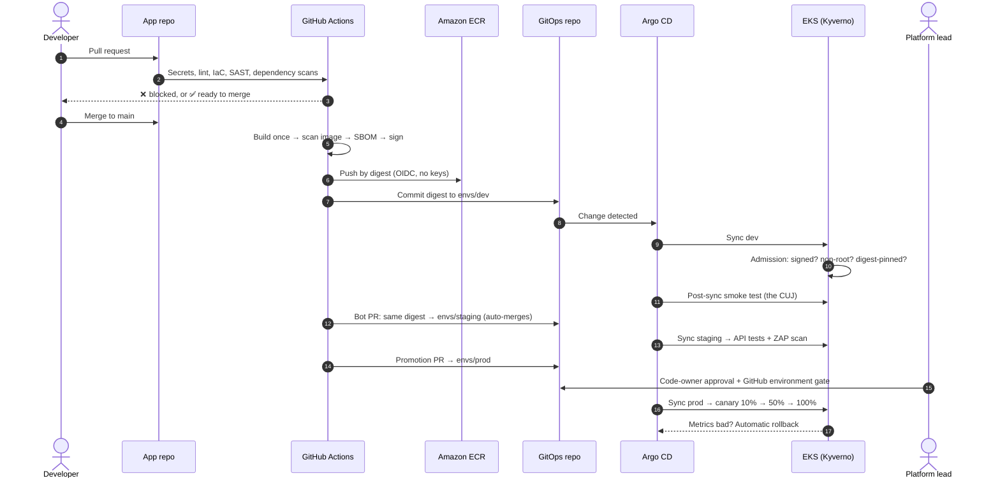
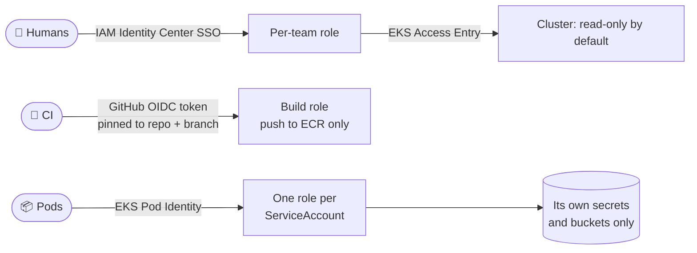
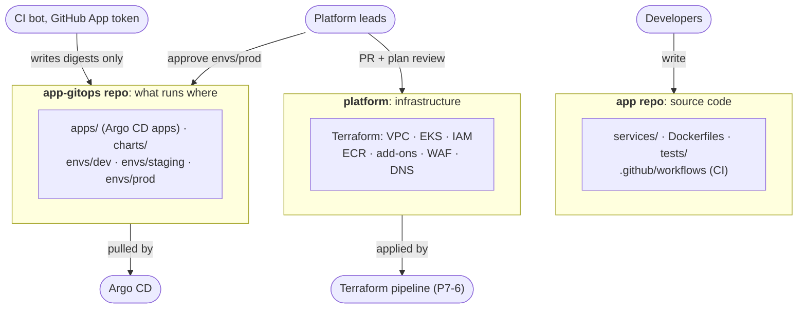

<div align="center">

# DevSecOps on EKS: the project template

**Take an application you just inherited all the way to a secure, observable,
production-grade platform on AWS EKS, one provable step at a time.**


[**Start the template →**](template/README.md) · [Phase 0](template/00-inherit-and-plan.md) · [Common mistakes](template/COMMON-MISTAKES.md) · [Day-2 operations](template/DAY-2-OPERATIONS.md) · [The guide](DEVSECOPS-GUIDE.md) · Explained simply: [Phase 0](study/p0-explained.md), [Phase 1](study/p1-explained.md) · Interview cases: [Phase 0](study/p0-inherit-and-plan.md), [Phase 1](study/p1-dev-environment.md)

</div>

---

## Contents

- [What you'll build](#what-youll-build)
- [Who this is for](#who-this-is-for)
- [The journey: 13 phases](#the-journey-13-phases)
- [Timeline and cost](#timeline-and-cost)
- [The security model in one picture](#the-security-model-in-one-picture)
- [How a change reaches production](#how-a-change-reaches-production)
- [No long-lived credentials](#no-long-lived-credentials)
- [Three repos, one job each](#three-repos-one-job-each)
- [Anatomy of a phase](#anatomy-of-a-phase)
- [Key decisions at a glance](#key-decisions-at-a-glance)
- [Golden rules](#golden-rules)
- [How to use it](#how-to-use-it)
- [Which app to practise on](#which-app-to-practise-on)
- [FAQ](#faq)
- [Repo map](#repo-map)
- [Credits](#credits)

---

## What you'll build



**Read it top to bottom:** code goes in through a pull request. CI scans it,
builds the image once, signs it, and pushes it by digest. CI never touches the
cluster: it only writes the new digest to the GitOps repo. Argo CD pulls that
change, and the cluster's admission control **rejects anything that skipped
the pipeline**. Users come in through DNS, the WAF and the ALB.
Everything that runs is watched, alerted on and backed up.

---

## Who this is for

- **Someone new to platform work** who wants one path to follow end to end,
  without stitching together ten tutorials. Each step says what to do, why,
  how to check it worked, and what usually goes wrong.
- **Anyone building a portfolio project.** Every control is *proven*: there's
  a drill or negative test that shows it fails safely, and that becomes your
  interview evidence.
- **EKS only, on purpose.** There are no ECS, Fargate or multi-cloud tracks.
  You still learn *when* ECS or Lambda would be the better choice ([P0-13](template/00-inherit-and-plan.md#p0-13-why-eks-the-compute-decision)), and how to
  [scale the template down](template/README.md#scale-the-template-to-your-situation) for a smaller team.
- **Built from real projects.** It merges the best part of
  [9 reference projects and courses](reference/README.md) and fixes what each
  of them got wrong.
- **A worked example throughout:** [Sock Shop](https://github.com/microservices-demo/microservices-demo):
  8 services in Go, Java and Node, plus MongoDB, MySQL and RabbitMQ. Swap in
  your own app; the steps don't change. Sock Shop is archived upstream, so for a real run use the [practice-app ladder](PRACTICE-APPS.md).

---

## The journey: 13 phases



Colours match the [security layers](#the-security-model-in-one-picture). Dashed
⏸ arrows mark tickets you **read** in P8 but **build** after P9 and P10. They're
listed in [Come back later](template/README.md#come-back-later).

| # | Phase | Goal | Key tools | You're done when… |
|---|---|---|---|---|
| 0 | [Inherit & plan](template/00-inherit-and-plan.md) | Know the app, people, risks and budget before touching infra | Discovery session + service manifest, ADRs, threat model, AWS Budgets | Someone new reads `docs/` in 20 min and can explain the app, the cost and the top 3 risks |
| 1 | [Dev environment](template/01-dev-environment.md) | A reproducible per-project toolchain; run the app locally | mise, devcontainer, DevPod, pre-commit | `git clone && devpod up .` → every tool works, the CUJ runs, no manual step |
| 2 | [Containerise](template/02-containerise.md) | Hardened, small, reproducible images | multi-stage Dockerfiles, hadolint, Trivy, Compose | Every image passes hadolint, Trivy, the size budget and the non-root check |
| 3 | [Local Kubernetes](template/03-local-kubernetes.md) | Learn Kubernetes with no cloud bill | KinD, Envoy Gateway, cert-manager, NetworkPolicy | PSA `restricted` enforced; default-deny proven; CUJ passes with policies on |
| 4 | [Cloud foundation](template/04-cloud-foundation.md) | State, network, EKS, add-ons, registry, all in code | Terraform, EKS Access Entries, ECR | `terraform destroy && apply` rebuilds everything with no manual step |
| 5 | [Identity & secrets](template/05-identity-and-secrets.md) | No long-lived credentials for humans, CI or pods | IAM Identity Center, GitHub OIDC, Pod Identity, ESO | No access keys exist anywhere; Gitleaks finds no secrets in history |
| 6 | [Run it well](template/06-run-it-well.md) | Survive drains, AZ loss, rollouts and spikes | HPA, PDB, topology spread, Karpenter | Rolling updates, node and AZ drains, Spot interruption: zero failed requests |
| 7 | [Security pipeline](template/07-pipeline.md) | Every change scanned, built once, signed; gates fail closed | GitHub Actions, Trivy, Semgrep, Syft, Cosign | Five deliberately bad PRs are all blocked; a vulnerable image never reaches ECR |
| 8 | [GitOps & enforcement](template/08-gitops-and-enforcement.md) | Git is the only way in; admission rejects the rest | Argo CD, Helm, Kyverno, Argo Rollouts | An unsigned image with a valid tag **cannot run**, even from your own registry |
| 9 | [Edge](template/09-edge.md) | HTTPS-only, real domain, WAF, zero-downtime rollouts | Gateway API, ALB controller, ACM, ExternalDNS, WAF | `https://` only, zero 502s during rollouts, SQL-injection probe blocked |
| 10 | [Observe & operate](template/10-observe-and-operate.md) | See, alert on, defend, recover, and run it day to day | ADOT, AMP, Grafana, Falco, GuardDuty, Security Hub, Lambda auto-remediation, OpenCost, k6, Velero | SLO dashboard links a slow request to its trace and logs; namespace restored within RTO |
| 11 | [Present it](template/11-present-it.md) | Anyone understands it in 5 minutes | README, evidence folder, ADRs | Someone reads it cold and explains the architecture and three trade-offs |
| 12 | [Multi-account](template/12-multi-account.md) *(later)* | One AWS account per environment | Organizations, SCPs, cross-account roles | A dev-account admin can't see or change anything in prod |

---

## Timeline and cost



| Phases | Time (part-time) | AWS cost |
|---|---|---|
| P0–P3 | 3–5 weeks | **$0**: everything runs locally |
| P4–P6 | 2–3 weeks | ~$3–5 per 4-hour session (EKS control plane ~$0.10/h + nodes) |
| P7 | 1 week | ~$0: GitHub Actions free tier + ECR storage pennies |
| P8–P10 | 3–4 weeks | ~$5–10 per session with the observability stack |
| P11 | 3–5 days | $0 |
| P12 *(later)* | 1–2 weeks | One cluster per environment account instead of one shared cluster |

> [!IMPORTANT]
> **Set an AWS Budget alert in [P0-7](template/00-inherit-and-plan.md#p0-7-set-the-budget-and-cost-guardrails) before you create anything, and `terraform destroy` at the end of every session.**
> With that discipline, one reference course reports **$30–50 for the whole build**.

---

## The security model in one picture

Each layer answers one question, and each layer assumes the one before it can fail.



**Why layer 3 matters most:** the pipeline only checks what goes *through* it.
Enforcement makes sure nothing goes *around* it: a `kubectl apply` from a
laptop, a stolen registry token, a teammate's "quick fix". **None of the
reference projects implemented admission control**; this template does, in P8.
The full model is in [DEVSECOPS-GUIDE.md](DEVSECOPS-GUIDE.md).

---

## How a change reaches production

One build, one digest, promoted through Git. Nothing is rebuilt or re-tagged
on the way to prod.



Rollback is a `git revert` in the GitOps repo, not a `helm rollback`.
Details: [P7-4](template/07-pipeline.md#p7-4-hand-the-digest-to-gitops-ci-never-deploys),
[P7-5](template/07-pipeline.md#p7-5-promotion-by-digest-never-by-tag),
[P8-8](template/08-gitops-and-enforcement.md#p8-8-progressive-delivery-with-argo-rollouts).

---

## No long-lived credentials

Stolen or over-broad credentials cause most cloud breaches. There are three
kinds of identity here, each with a short-lived, scoped mechanism and **no
static keys anywhere**.



**Never:** IAM users with access keys · keys or kubeconfig in GitHub secrets · the node instance role or keys in env vars for pods.

Details: [Phase 5](template/05-identity-and-secrets.md).

---

## Three repos, one job each



**Why a separate GitOps repo:** code commits don't wake Argo CD, CI never
needs write access to the source code, and the GitOps repo's history *is* the
deployment log. See [P1-1](template/01-dev-environment.md#p1-1-decide-the-repository-layout).

---

## Anatomy of a phase

Every phase file has the same shape, so you always know where you are:

| Section | What it gives you |
|---|---|
| **Goal** | One sentence: what's true when you finish |
| **Why** | What breaks if you skip it, with what the reference projects got wrong |
| **Steps** | Tickets `P<phase>-<n>` with tick-box acceptance criteria. Copy them into Jira or GitHub Projects |
| **Prove it** | The drill or negative test that shows the control really works |
| **Common mistakes** | Seen in real projects, with the fix |

<details>
<summary><b>Example ticket: P6-3 PodDisruptionBudgets</b></summary>

```yaml
apiVersion: policy/v1
kind: PodDisruptionBudget
metadata: { name: front-end, namespace: sock-shop }
spec:
  minAvailable: 2
  selector: { matchLabels: { app.kubernetes.io/name: front-end } }
```

- [ ] A PDB per service with ≥ 2 replicas
- [ ] ⚠️ **Never** `minAvailable: 1` on a 1-replica Deployment: node drains (and so cluster upgrades and Karpenter consolidation) block forever
- [ ] **Drill:** `kubectl drain <node> --ignore-daemonsets --delete-emptydir-data` under load → zero failed requests; the drain waits for replacements

</details>

**Markers you'll see:**
- `[OPT]`: optional, with a *Use when* note.
- `[ADVANCED]`: a deeper alternative track.
- `Decision`: write an ADR.
- ⏸: come back after a later phase.

---

## Key decisions at a glance

The template makes these choices so you don't stall on them. Change any of
them with an ADR. The [full table with reasons](template/README.md#decisions-this-template-makes-for-you)
says where the reference projects differ.

| Area | Choice |
|---|---|
| Infrastructure | **Terraform**, remote state in S3 with locking, never committed |
| Local cluster | **KinD** (3 control plane + 3 workers): learn Kubernetes for $0 |
| Cluster access | **EKS Access Entries** (not the legacy `aws-auth` ConfigMap) |
| Pod → AWS | **EKS Pod Identity** (IRSA taught once, for contrast) |
| CI → AWS | **GitHub OIDC**, trust pinned to repo + branch/environment |
| Delivery | **GitHub Actions** builds; **Argo CD** deploys; CI never runs `kubectl` |
| Secrets | **AWS Secrets Manager + External Secrets**; OpenBao as the advanced track |
| Supply chain | **Cosign keyless** signing in CI, verified by **Kyverno** at admission |
| Routing | **Gateway API**: Envoy Gateway locally, the ALB on EKS, same `HTTPRoute`s |
| Observability | **OpenTelemetry** everywhere; LGTM locally for free, AWS-managed on EKS |
| Runtime security | **Falco** + **GuardDuty** |

---

## Golden rules

1. **Never skip "Prove it".** A control you haven't seen fail is a control you don't know works.
2. **Destroy after every AWS session.** Rebuilding from code is part of the test.
3. **Promote by digest, never by tag.** The image that passed staging is byte-for-byte the one in prod.
4. **CI builds, Argo CD deploys.** No cluster credentials in CI, ever.
5. **Raw YAML before Helm.** You can only judge a template once you've written what it should produce.
6. **Read the phase's [common mistakes](template/COMMON-MISTAKES.md) before you start it.** Five minutes there saves an afternoon of debugging.
7. **⏸ means come back later.** Read it now; build it when the phase it needs is done.

---

## How to use it

1. **Pick your app** ([practice-app ladder](PRACTICE-APPS.md)) and **get the code the right way**: fork-then-clone for an open-source app, plain clone for a company repo ([P1-0](template/01-dev-environment.md#p1-0-get-the-code-clone-fork-or-both)).
2. **Start at [Phase 0](template/00-inherit-and-plan.md)** and go in order. The
   [dependency graph](template/README.md#dependency-graph) shows the safe overlaps.
3. **Copy each phase's tickets into your tracker** as you reach it. IDs like `P4-3` map straight onto a Jira key.
4. **Write an ADR** whenever a ticket says *Decision* (template in [P0-8](template/00-inherit-and-plan.md#p0-8-start-the-adr-log)).
5. **Keep evidence as you go:** screenshots and logs of every drill go into `docs/evidence/`, ready for [P11](template/11-present-it.md).
6. **Read the plain-English walkthrough** ([Phase 0](study/p0-explained.md), [Phase 1](study/p1-explained.md)), then **test yourself** with the phase's interview cases ([Phase 0](study/p0-inherit-and-plan.md), [Phase 1](study/p1-dev-environment.md)): mock-interview cases (a scenario, then the follow-ups an interviewer pushes with), each with a model answer. Add a follow-up whenever a run surprises you.

---

## Which app to practise on

The worked example in the text is Sock Shop, but Sock Shop is **archived**
upstream. To actually run the template, follow the
[practice-app ladder](PRACTICE-APPS.md): seven apps in order, each adding
something the previous ones didn't.

| # | App | Role |
|---|---|---|
| 1 | Podinfo | Platform smoke test |
| 2 | **AWS Retail Store** | **Main project: the full P0 → P11 run** |
| 3 | Online Boutique | Second app: prove the template transfers |
| 4 | OpenTelemetry Demo | Observability practice with switchable failures |
| 5 | Bank of Anthos | Security focus |
| 6 | TeaStore | First diagnosis drill |
| 7 | Train-Ticket + fault-replicate | Final hard mode: 22 real failures in 41 services |

---

## FAQ

<details>
<summary><b>Why EKS only?</b></summary>

One deep path beats four shallow ones. Every reference project used AWS and
EKS, and the concepts transfer: GitOps, admission control, OIDC trust,
SLOs and Gateway API work the same on any Kubernetes. Alternatives (ECS, other
clouds) appear only as one-line ADR notes.
</details>

<details>
<summary><b>Shouldn't some of this be ECS or Lambda instead?</b></summary>

Often, yes, in a real job. Lambda fits event-driven work under 15 minutes;
ECS + Fargate fits a single team with under ~20 services and no need for the
Kubernetes ecosystem. This template uses EKS for a **learning** reason, and
says so. [P0-13](template/00-inherit-and-plan.md#p0-13-why-eks-the-compute-decision)
teaches the decision framework and has you write the "why EKS" ADR, including
the case against it. Real systems mix them: P10-5c uses Lambda for
auto-remediation next to EKS.
</details>

<details>
<summary><b>I'm using this at work, not for learning. Do I need all of it?</b></summary>

No. [Scale the template to your situation](template/README.md#scale-the-template-to-your-situation)
maps each kind of company to which tickets to keep, keep minimal, or defer.
The rule: adopt tools that remove a manual, error-prone step; defer tools
that add a new decision-making system until something forces them.
</details>

<details>
<summary><b>Why KinD for the local cluster, and not k3s, minikube or vcluster?</b></summary>

KinD runs the same upstream Kubernetes as EKS, starts a multi-node cluster in
about a minute, and costs nothing. k3s is conformant too, but bundles its own
ingress, CNI and storage that you'd have to turn off.

**vcluster isn't an alternative to KinD.** It runs *inside* an existing EKS
cluster, so it needs one running, and it isn't free. It's in the template as
an optional tool for per-PR preview environments
([P8-10](template/08-gitops-and-enforcement.md#p8-10-opt-vcluster-virtual-clusters-inside-the-shared-cluster)).
On Podman, use `KIND_EXPERIMENTAL_PROVIDER=podman`.
</details>

<details>
<summary><b>Why a separate GitOps repo instead of manifests in the app repo?</b></summary>

So that CI can write *only* image digests, never source code. Code commits
don't trigger deploys, there are no CI loops, and "what's running in prod,
since when?" is just the GitOps repo's history.
</details>

<details>
<summary><b>Why Gateway API instead of Ingress?</b></summary>

Ingress is frozen. Gateway API splits ownership: the platform team owns the
`Gateway` (the ALB, TLS and WAF), and app teams own their `HTTPRoute`s. It also
has traffic splitting and redirects built in, and the same routes work on KinD
and on EKS. See [P9](template/09-edge.md#why-gateway-api-adr).
</details>

<details>
<summary><b>Do I need Cilium, Hubble or a service mesh?</b></summary>

No. EKS uses the AWS VPC CNI by default, and Hubble only exists if Cilium is
your CNI. To learn Cilium for free, swap it in on KinD
([P3-7b](template/03-local-kubernetes.md#p3-7b-opt-cilium-instead-of-kindnet-hubble-l7-policy-wireguard)).
[P8-7](template/08-gitops-and-enforcement.md#p8-7-networkpolicy-on-eks) says when Cilium on EKS is worth it.
A service mesh (Linkerd, Istio ambient, Cilium) is optional too:
[P8-11](template/08-gitops-and-enforcement.md#p8-11-opt-service-mesh-and-mtls-when-and-how)
explains when it's worth it.
</details>

<details>
<summary><b>Let's Encrypt or ACM for certificates?</b></summary>

ACM for anything behind the ALB: the ALB can only serve ACM certificates.
Use cert-manager with Let's Encrypt when TLS ends *inside* the cluster: an
in-cluster gateway, internal tools, or a homelab. See
[P9-4b](template/09-edge.md#p9-4b-opt-lets-encrypt-certificates-with-cert-manager).
</details>

<details>
<summary><b>What does it cost in total?</b></summary>

P0–P3 are free. After that you pay per session, roughly $3–10 for a few hours,
as long as you destroy at the end. See [Timeline and cost](#timeline-and-cost).
A forgotten NAT gateway or EKS cluster is the classic surprise bill, which is
why the budget alert comes first.
</details>

---

## Repo map

```
.
├── README.md              ← you are here: the visual overview
├── template/              ← the plan itself
│   ├── README.md          phase map, dependency graph, decisions, explainers
│   ├── 00-…12-*.md        one file per phase: Goal, Why, tickets, Prove it, mistakes
│   ├── COMMON-MISTAKES.md everything the reference projects got wrong, by phase
│   ├── DAY-2-OPERATIONS.md running it: rhythm, troubleshooting path, 18 incidents, drills
│   └── WHEN-IT-ALL-RUNS-TOGETHER.md  the system view: where tools overlap, is it worth adding
├── study/                 per phase: pN-explained.md (plain English) + pN-*.md (mock-interview cases)
├── PRACTICE-APPS.md       which app to run through the template, in what order
├── cursor/                Cursor rule to copy into each project folder (P1-0)
├── DEVSECOPS-GUIDE.md     the three-layer model the template is built on
└── reference/             reviews of the 9 projects the template was merged from
```

---

## Credits

Built by merging and correcting these sources, each reviewed in
[`reference/`](reference/README.md):

- **Abhishek Veeramalla:** Day-7 end-to-end DevSecOps, VM-to-Kubernetes onboarding, the Ultimate DevOps project
- **Cloud With VarJosh:** the Jenkins + EKS mega project
- **DevOpsShack (Aditya Jaiswal):** the production-grade DevSecOps project
- **StackSimplify (Kalyan Reddy):** the real-world AWS DevOps project
- **abhishekpanda0620:** the DevSecOps platform template
- **The author's own Sock Shop platform plan:** the ticket format, drills and acceptance criteria
