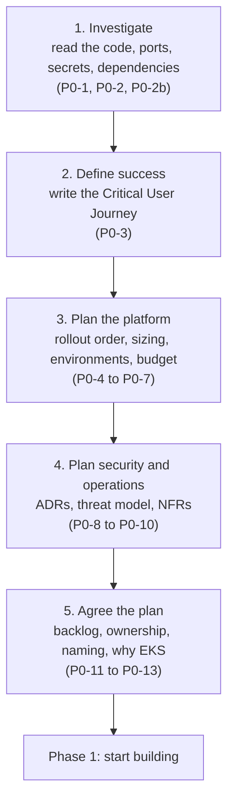
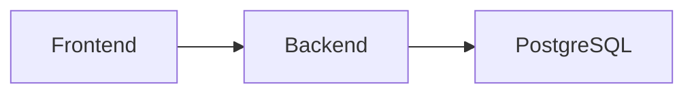
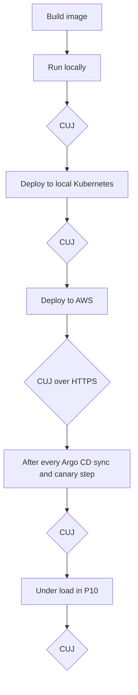
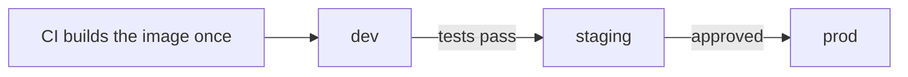
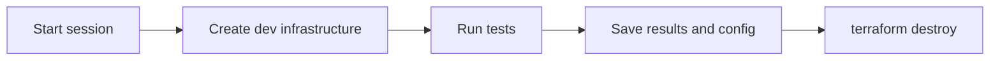

# Phase 0 explained simply

A plain-English walk through [Phase 0: Inherit & plan](../template/00-inherit-and-plan.md).
Read this first. Then test yourself with the
[interview cases](p0-inherit-and-plan.md).

Examples use the **Podinfo** run (a small Go app, fork
[`nazmur96/podinfo`](https://github.com/nazmur96/podinfo)). Where the text
says "Podinfo's docs", it means that project's `platform/docs/` folder.

---

## The idea in one paragraph

Think of Phase 0 as planning a house before anyone pours concrete. You find
out what kind of house is wanted, what the budget is, where the doors go,
what could go wrong, and who is responsible for what. In DevOps it's the same,
for an application and its platform: **understand the app, decide how you'll
prove it works, plan the platform, find the risks, and write it all down,
before you create any AWS resources.**

Imagine a company hands you an app and says *"please deploy this on AWS with
Kubernetes."* Your first job is not to create an EKS cluster. It's to find
out what you've been given and write a plan someone else can read, check and
follow.

## The whole phase on one page



What you end up with is mostly documents, committed to the platform repo:

```
platform/docs/
├── questions.md        what the code told you, and what's still open
├── inventory.md        every component, its port, what it calls
├── cuj.md              the test that proves the app works
├── sizing-and-cost.md  how big, how much money
├── environments.md     dev / staging / prod, and how they're separated
├── threat-model.md     what could go wrong, and what fixes it
├── nfr.md              targets: uptime, speed, recovery, limits
├── ownership.md        who does what between devs and platform
├── conventions.md      how everything is named
├── adr/                one file per big decision
└── backlog.md          the work, as tickets

app repo: MANIFEST.md   the service's contract with the platform
```

---

## 1. Understand the app before you deploy it

*Tickets P0-1, P0-2, P0-2b*

### P0-1: read the code, list what you don't know

Read the README, the dependency file (`go.mod` for Go), the Dockerfile, the
deploy files, the CI workflows, and **every place the app reads config or
secrets**. Don't trust the README, and don't assume the app behaves like
others you've seen.

For Podinfo, the reading has to answer questions like these:

| What you look at | Why it matters |
|---|---|
| Which port it listens on | Send traffic to the wrong port and requests fail while the pod looks fine. Podinfo listens on **9898**. |
| Health endpoints | A health check can pass while real requests fail. |
| The JWT signing secret | Podinfo has a hardcoded default. Anyone who reads the code can forge tokens. |
| `/env` and `/configs` | They print the app's environment and config files, which is where secrets usually live. |
| `/panic`, `/delay`, `/store` | They can crash the app, tie it up, or fill its disk. |
| Start-up and shut-down | Get them wrong and pods restart for no reason, or drop requests during every deploy. |

You write this up in **`questions.md`**, in two parts:

- **Already answered by the code**, with the file and line that proves it.
- **Still open**, with *why it matters* and *how you'll find out*: read
  more code, run an experiment later, make a decision (an ADR), or ask a
  person. Podinfo is open source, so there's no developer to ask, and every
  row is answered by code, experiment or decision.

> **The habit to build:** don't write "the app is stateless" because the
> README says so. Check whether it writes files, keeps sessions, or caches
> anything locally.

**Before reading anything on a fork,** make it safe: Actions turned off,
the workflow token read-only, no way to push to the original project.
Otherwise the original project's release pipeline could run on your copy.

### P0-2: make an inventory

The inventory turns your findings into a map. For an app with several parts
it might look like this:

| Component | Port | Calls | Purpose |
|---|---|---|---|
| Frontend | 3000 | Backend | What users see |
| Backend | 8080 | PostgreSQL | Business logic |
| PostgreSQL | 5432 | nothing | Stores the data |

And a simple diagram of who calls whom:



**Why bother?** Later (P8) you'll write Kubernetes NetworkPolicies, the rules
about which pods may talk to which. The diagram becomes that allow-list. If
the frontend should never talk to the database directly, the map makes that
obvious.

Podinfo is a single service, but the code showed it *can* call three things,
each only when a flag turns it on: Redis, another Podinfo (`/echo`), and a
tracing collector. So its network rules depend on its configuration.

### P0-2b: write the service manifest

The inventory is the platform team's map of everything. The **manifest**
(`MANIFEST.md`, kept in the app's own repo) is *one* service's contract with
the platform: what it needs and how it behaves. It has nine sections:

1. Identity: language, runtime version, how it's packaged
2. Network: port, protocol, public or internal
3. Compute: CPU, memory, scaling
4. Data: databases, files, queues
5. Observability: health checks, logs
6. Config and secrets: where each value comes from
7. **Start and stop:** how long it takes to start; does it finish open
   requests when told to stop?
8. **Dependencies:** what it calls, and what happens when one is down
9. **Ownership:** who gets called when it breaks

The last three are the ones people skip, and the ones you need at 3 a.m.

**Why shutdown matters:** during a deploy, Kubernetes replaces pods. If a pod
stops instantly while it's still answering a user, that request fails. So the
manifest records whether the app handles the stop signal (SIGTERM) and how
long it needs to finish.

You fill the manifest in **with** the developers, in a short meeting. The
four questions that matter most: *which port and protocol, does it write to
disk, does it handle SIGTERM, and which database (and is the data real)?*

> **Record what's true, not what a template expects.** Podinfo has no
> database, so its manifest says so. Don't invent one. You still check
> whether it writes to local disk (it does: `/store` writes to `/data`).

---

## 2. Define exactly what "working" means

*Ticket P0-3: the Critical User Journey*

There's a difference between two questions:

- Is the infrastructure running?
- Can someone actually use the app?

A pod can say `Running` and `Ready` while the app can't reach its database.
A health endpoint can return 200 while the feature users need is broken.

The **Critical User Journey (CUJ)** is a short, repeatable set of checks that
proves the app works from the user's side. For a shop it would be: open the
site → log in → place an order → check the order was saved.

For Podinfo, `cuj.md` defines these steps:

| Step | What a pass proves |
|---|---|
| `GET /version` | The build running is the one CI built: the commit must match, not say `unknown` |
| `GET /healthz`, `GET /readyz` | The platform sees it as alive and ready |
| `GET /` | A real app route answers with the right JSON |
| Issue a JWT, then validate it | The token feature works with *our* secret |
| A token signed with the **default** secret | Is **rejected** (added once the real secret is wired in, P5) |
| Probe the dangerous routes | They're switched off (after the app is patched) |

**Check the response body, not just the status code.** `/version` can return
`200 OK` with `"commit": "unknown"`. The request worked, but you still can't
tell which build answered.

**Health checks can lie.** Podinfo's fault-injection mode breaks normal
requests on purpose but leaves `/healthz` answering 200. So a "healthy" pod
can be broken for users. A CUJ made only of health checks would pass.

**Test dangerous routes safely.** To prove `/panic` is switched off, don't
call it: if the switch ever breaks, your test crashes the app. Call it with
the wrong method (`POST` instead of `GET`): an unregistered route answers
404, a still-registered one answers 405, and the crash code never runs.

You run the same CUJ at every stage:



It becomes a script (`scripts/cuj.sh`) in P2 and then runs in CI.

> **Lesson:** decide how you'll prove a release works *before* you create
> the release.

---

## 3. Plan the rollout order

*Ticket P0-4*

A real company may hand you dozens of services. Moving them all at once makes
every problem hard to trace.

Each service is tagged **critical, important, medium or low** by how much an
outage would hurt the business. **The product owner decides this, not the
engineers.** Engineers explain the technical risk and effort, but they
shouldn't decide on their own that payments matter less than a reporting
dashboard.

Then the rule: **least critical first, most critical last.** Your first
migrations are where your patterns are still wrong, so mistakes should land
on something cheap.

The **pilot** (the first few services) should cover a range of types,
**including at least one that stores data**, because a stateless web app
won't teach you about storage, backups, recovery or connection limits.

> **For Podinfo:** it has no stateful part. Don't pretend it has a database
> to tick the box. Write down that the pilot can't teach those lessons, and
> where you'll learn them instead (the next app, Retail Store).

---

## 4. Estimate capacity instead of guessing

*Ticket P0-5*

A common beginner mistake is picking instance sizes because they "seem
about right". Use measurements:

- **Existing app:** read the CPU and memory numbers from Prometheus or
  CloudWatch.
- **New app:** run it, push the CUJ through it, and watch `docker stats`.

Then add it up:

```
app requests × replicas (plus one for a canary)
+ platform tools (Argo CD, monitoring, policy engine: about 2–3 GiB)
+ per-node agents (DaemonSets)
× 1.3 headroom
```

**The trap on EKS: a node can have free memory and still refuse new pods.**
Each EKS node can only hold a fixed number of pods, set by its network
interfaces: a `t3.medium` holds 17, a `t3.large` 35. Per-node agents and
platform tools use up those slots before your app arrives. So you size by
pod count as well as by CPU and memory.

The template's `t3.large` × 3 is an example for its own lab, not a rule for
every cluster. Podinfo's numbers are placeholders until they're measured in
P2 and P3.

---

## 5. Environments, cost and access

*Tickets P0-6, P0-7*

### Environments

| Environment | What it's for |
|---|---|
| dev | Experimenting; things break, on purpose |
| qa | Testers check features and log bugs |
| staging | Rehearse releases on a copy of prod; nobody experiments here |
| prod | Real users |
| dr | Takes over if prod is lost; built only when needed |

**Five environments doesn't mean five clusters.** Three common ways to
separate them:

| Approach | In house terms | Trade-off |
|---|---|---|
| One cluster, a namespace per environment | Rooms in one building | Cheapest, but a cluster problem hits everyone |
| **Shared non-prod cluster, separate prod cluster** | A separate building for prod | Prod is isolated; costs a second control plane. **The template's default.** |
| A separate AWS account per environment | Separate buildings, each with its own locks | Strongest isolation, most setup |

Namespaces on their own aren't full isolation. Each one still needs its own
permissions (RBAC), quotas, network rules and Argo CD app.

For learning: build **dev** end to end, write prod's settings down, and build
prod once as a final exercise. For disaster recovery the default is no
standby cluster: rebuild from Terraform, the gitops repo and backups when
needed, and practise that rebuild.

### Moving a release between environments



The **same image digest** moves through every step. A digest is an ID
calculated from the image's contents, so it can't point at something else
later, unlike a tag such as `latest`. Same digest means prod gets exactly the
image that was tested. Rebuilding for each environment would give you a
different, untested image.

### Cost guardrails

AWS charges even when nobody uses your app: the EKS control plane, nodes,
load balancers, NAT gateways, network endpoints, monitoring storage. So:

1. **Set a budget with alerts before creating anything.** Alerts at 50%,
   80% and 100%, plus a *forecast* alert. Check for existing budgets first.
   Two budgets on the same spend means the lower one always fires first.
   (Podinfo: one $40/month budget; an old $20 one was deleted.)
2. **Know that a budget is not a spending cap.** Billing data arrives hours
   late, so the alert tells you about money already spent.
3. **Tear down after every session.** That's the real protection:



Read the destroy plan first, so you don't delete something you meant to keep.

Two cost traps worth knowing: an EKS cluster on an old Kubernetes version
costs **6× more** (extended support), and T3 instances under sustained load
bill extra CPU credits.

Saving money can create risk. Podinfo's dev network has no NAT gateway
(saves about $100/month), so the nodes have public IPs, and one wrong
firewall rule exposes them. That's fine **only** if it's a written decision
(ADR-0002) with the compensating controls listed.

### Signing in to AWS

**Never create long-lived access keys for people.** First look at how people
already sign in. Podinfo's account already uses **Authentik** (a self-hosted
login service) to sign in to an AWS role, with `aws login` for the CLI. So
the project uses that, and doesn't add IAM Identity Center as a second login
system (ADR-0004). If no federated login exists yet, set that up first;
don't assume it's there.

---

## 6. Write down why you decided things

*Ticket P0-8: Architecture Decision Records*

An **ADR** is a short file for one decision. It says:

- what problem you faced
- what you chose
- why
- the downsides
- when you'd reconsider

Example, in plain words:

> **Decision:** use EKS for this learning project.
> **Why:** the goal is to learn platform engineering: GitOps, Kyverno,
> workload identity.
> **Downside:** cluster upkeep and cost that one small app doesn't justify.
> **Reconsider if:** this became a real production service that ECS or
> Lambda could run more simply.

That's far stronger in an interview than "the tutorial used EKS."

Podinfo's other decisions include: app secrets in AWS Secrets Manager,
delivered by External Secrets Operator (ADR-0006); CI builds the image and
Argo CD deploys it (ADR-0007); no NAT in dev (ADR-0002).

**When a decision changes, don't edit the old ADR.** Write a new one and
mark the old one "Superseded by …". Podinfo did exactly this: ADR-0003
(Identity Center) was replaced by ADR-0004 (Authentik) within an hour.

---

## 7. Find the risks, using STRIDE

*Ticket P0-9: threat model*

A threat model answers four questions: *what are we protecting, how could
someone get in, what damage could they do, and what will stop them?*

**What needs protecting** is more than the app: AWS credentials, app secrets
and customer data, the CI pipeline, the image registry, Terraform state, the
Kubernetes API, the **gitops repo** (a commit there *is* a deploy), and the
**login system** (whoever controls Authentik can sign in to AWS).

The template sorts risks with **STRIDE**:

| Letter | Means | Example | Fixed in |
|---|---|---|---|
| **S** Spoofing | Pretending to be someone trusted | Stolen CI credentials deploy bad code | P5 OIDC, P7 signing, P8 verify |
| **T** Tampering | Changing something that should be trusted | An image in the registry is swapped | P4 immutable tags, P7/P8 Cosign + Kyverno |
| **R** Repudiation | Nobody can prove who did what | "Who changed prod?" | P8 gitops history, P4 CloudTrail |
| **I** Information disclosure | Someone sees what they shouldn't | The JWT secret leaks via Git, Terraform state, an image layer, or `/env` | P1 Gitleaks, P4 state, P5 secrets, P2 layers |
| **D** Denial of service | Real users can't get in | A traffic flood, or `/panic` in a loop | P6 limits, P9 rate limits |
| **E** Elevation of privilege | Getting more power than intended | A hacked pod uses an over-powerful IAM role | P5 least privilege, P8 Pod Security Admission, P10 Falco |

Every risk must point at the phase that fixes it. Writing a control down
doesn't make it exist; it's a plan until that phase is done.

### Podinfo's own risks

Read the app's routes in the code, not the README:

- `/env` and `/configs` show the environment and config files: the two
  normal ways of handing a secret to an app. So **both** leak secrets.
- `/panic` kills the process.
- `/delay` holds resources for as long as the caller asks.
- The hardcoded JWT default lets anyone forge tokens.

The fix (ADR-0006, ADR-0008): switch those routes off in our build of the
app, and prove it with the CUJ.

> **Common mistake:** "I blocked `/panic` on the load balancer, so it's
> safe." Not quite. Another pod inside the cluster can still call the app
> directly, and NetworkPolicies control which pods can connect, not which URL
> paths they request. Blocking at the edge doesn't replace fixing the app.

> **Use today's terms:** the built-in Kubernetes control is **Pod Security
> Admission (PSA)**. The older PodSecurityPolicy (PSP) was removed in
> Kubernetes 1.25. Kyverno adds more flexible policies on top.

---

## 8. Requirements that aren't features

*Ticket P0-10: non-functional requirements (NFRs)*

A **feature** is what the app does ("place an order"). A **non-functional
requirement** is how well, and within what limits, it must do it: uptime,
speed, traffic, recovery, data loss, cost.

Three terms to know:

| Term | Plain meaning | Example |
|---|---|---|
| **SLO** (Service Level Objective) | Your quality target | 99.9% of requests succeed over 30 days |
| **RTO** (Recovery Time Objective) | How long you may be down after a failure | Back within 2 hours |
| **RPO** (Recovery Point Objective) | How much data you may lose, in time | No more than the last 5 minutes |

These come from the business, and early numbers are drafts. A target on paper
isn't proof the app meets it; you refine it once you have measurements.

> **For Podinfo:** it has no database, so there's no app-data RPO. Don't
> invent one. But the rebuild still depends on Terraform state, the gitops
> repo and the secret values, so write down how *those* are protected.

### Denial of wallet: limits, not just goals

An attacker, or just a traffic spike, can make the app scale up and up, and
the bill with it. So you also set **ceilings**:

- a maximum number of pod replicas
- a limit on how many nodes can be added
- quotas that match the allowed replica count
- room for **one extra node**, so node upgrades can still happen
- the budget alerts, and tearing down dev

**Keep the numbers consistent.** A PodDisruptionBudget of
`minAvailable: 2` with only 2 replicas means Kubernetes can never move a
pod, so node upgrades get stuck. Run at least 3.

---

## 9. Turn the plan into tickets and agree it

*Ticket P0-11*

Turn everything into work items:

| Task | Result |
|---|---|
| Build and test the app image | A repeatable CI build |
| Create dev networking | Terraform code |
| Deploy Podinfo | Kubernetes Deployment and Service |
| Deliver the JWT secret safely | Secrets Manager + External Secrets |
| Check every release | The automated CUJ |
| Switch off dangerous routes | An app patch plus a CUJ check |

Mark work you skip, so skipping is visible:

- `[OPT]`: could be done, chosen not to (e.g. a service mesh).
- `n/a`: can't be done with this app, and where you'll learn it (e.g.
  database migrations: Podinfo has no database → next app).

Then get the plan agreed: share the inventory, sizing, cost, environments
and requirements with the team. **On a solo project,** you sign it off
yourself: a dated "accepted" line at the end of `backlog.md`.

It can feel like paperwork, but it stops a project turning into a pile of
tools with no agreed goal.

---

## 10. Agree who owns what

*Ticket P0-11b*

Infrastructure can be perfect and still fail because nobody knew who should
act. Picture a bad release: who approves prod? Who rolls back? Does the
pipeline do it by itself? While people argue, users see errors.

| Developers own | Platform owns | **Agreed in writing, together** |
|---|---|---|
| Dockerfile and build | The CI/CD automation | Image tags: git commit SHA, **never `latest`** |
| Tests | The deploy gate | What blocks a deploy (e.g. critical security findings) |
| Branch protection on their repo | How rollback works | Who approves prod |
| Error handling in the app | Infrastructure alerts | Who triggers a rollback (either side may `git revert`) |
| Versioning | Environment config | Who keeps each service manifest up to date |

The third column is the point of the exercise.

Two more rules:

- During an incident, alerts go **by layer**: load balancer and node problems
  → platform; app errors → developers. **One person** leads the incident.
- If anyone fixes something by hand (console or `kubectl`) during an
  incident, that change goes back into Git within 24 hours. Otherwise the live
  system and Git quietly drift apart.

> **Solo trap:** GitHub never lets you approve your own pull request. If prod
> changes require a code-owner review and you're the only code owner, you can
> never deploy to prod. Solo, the prod gate is a **GitHub Environment `prod`
> with you as the required reviewer** instead.

> **Lesson:** automation can't fix unclear ownership.

---

## 11. Name things the same way everywhere

*Ticket P0-12*

If one person calls the cluster `prod-cluster`, another `production-eks` and
a third `eks-main`, it soon becomes hard to find things, write permissions,
or read the bill. Pick a pattern before the first resource exists, write it
in `conventions.md`, and never debate it again.

Podinfo's real conventions:

| Thing | Example |
|---|---|
| Dev VPC | `podinfo-dev-vpc` |
| Non-prod cluster | `podinfo-dev-eks` |
| Namespaces | `podinfo-dev`, `podinfo-staging`, `podinfo-prod` |
| Secret path | `podinfo/dev/podinfo/jwt-secret` (pattern `{project}/{env}/{service}/{name}`) |
| Image tag | the git commit SHA |
| Environment names | exactly `dev`, `staging`, `prod`, never `production` or `prd` |

Also standardised: AWS tags, Kubernetes labels, Terraform names, branch names
and commit messages.

Why the environment names matter so much: if GitHub calls it `production` and
the AWS trust policy says `prod`, deploys to prod fail with "not authorized",
and nothing in the error tells you why.

These rules get enforced later by Terraform, CI checks, ECR settings and
Kyverno.

---

## 12. Is EKS actually the right choice?

*Ticket P0-13*

Don't use Kubernetes just because you're learning DevOps. Compare the three
AWS options:

| Option | Good for |
|---|---|
| **Lambda** | Event-driven jobs, scheduled tasks, glue between AWS services. Must finish in 15 minutes. |
| **ECS on Fargate** | Running containers without managing servers or a Kubernetes cluster. Often simpler for one team with a handful of services. |
| **EKS** | When you need the Kubernetes ecosystem: GitOps, admission policies, operators, a shared platform for several teams. |

A quick way to decide:

| Question | Likely choice |
|---|---|
| Is it a short, event-driven task? | Lambda |
| Containers, but no need for Kubernetes features? | ECS on Fargate |
| You need Kubernetes and its ecosystem? | EKS |

EKS also brings ongoing work: add-ons, node updates, a version upgrade every
few months, security controls, monitoring, on-call.

**So why EKS here?** Because the project's goal is to *learn* platform
engineering: GitOps, Kyverno, workload identity. That's a valid learning
reason. It is **not** the same as saying EKS is the best production choice
for Podinfo; for Podinfo alone, ECS would win (ADR-0009). Being able to say
that in an interview shows you understand the trade-off, not just how to
create a cluster.

---

## What to remember

You don't need to memorise the ticket numbers. Remember the questions behind
them:

| Question | What it protects you from |
|---|---|
| What does the app actually need? | Wrong infrastructure, failed deploys |
| How do I prove it works? | Calling it a success because pods are running |
| How much capacity does it need? | Paying too much, or running out |
| How are environments and costs controlled? | Breaking prod by accident, surprise bills |
| What could go wrong, and how do we limit it? | Security incidents and outages |
| Who owns each responsibility? | Confusion during deploys and incidents |
| Why did we choose these tools? | Complex technology with no real reason |

**The big lesson:** DevOps isn't just writing Terraform, Kubernetes YAML and
pipelines. Those tools *carry out* a design. Phase 0 is where you understand
the app, make decisions you can defend, and write down the requirements
before you automate anything.

When someone asks *why this port, this secret setup, this security policy,
this platform?*, you should be able to point to the evidence and explain the
trade-off. That's the difference between knowing how to deploy an app and
knowing how to design a platform that runs it safely.

## How you know Phase 0 is done

- Someone who has never seen the project can read `docs/` in **about 20
  minutes** and explain what the app does, what you'll build first, what it
  will cost, and the top three risks.
- Every decision you make in later phases points back to an ADR or a
  requirement from Phase 0.

**Next:** [Phase 1 explained simply](p1-explained.md). But first, practise answering out loud with the
[Phase 0 interview cases](p0-inherit-and-plan.md).
