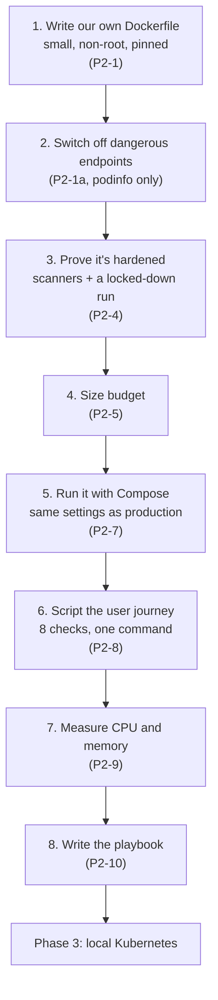
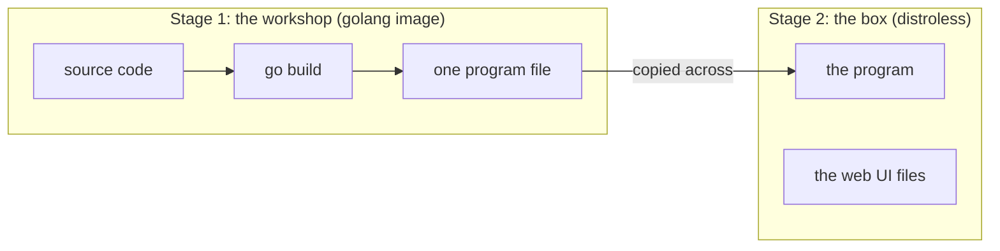

# Phase 2 explained simply

A plain-English walk through [Phase 2: Containerise](../template/02-containerise.md).
Read it before you start the phase. Then test yourself with the
[Phase 2 interview cases](p2-containerise.md).

Examples use the **Podinfo** run (fork
[`nazmur96/podinfo`](https://github.com/nazmur96/podinfo), a small Go app).
Lines marked **"In the Podinfo run"** are what actually happened, with the
measured numbers and the mistakes we hit.

Sections 7 and 8 (the journey script and measuring resources) go slowly,
from zero. Those are the parts most people find hardest.

---

## The idea in one paragraph

Phase 1 made the app run on your laptop. Phase 2 puts it in a **container
image**: a sealed box holding the program and exactly what it needs, nothing
else. That box is what CI will build once, sign, and ship unchanged to dev,
staging and prod. So this phase is about making the box **small, locked
down, and provably correct**, and writing a script that proves "it works" the
same way everywhere from now on.

## The whole phase on one page



P2-2 and P2-3 (Java and Node images) don't apply to Podinfo; they come with
Retail Store. P2-6 (ARM images) is optional, and we skipped it.

---

## 1. Write our own image

*Ticket P2-1*

### Why not use upstream's image?

Podinfo already publishes an image. But it ships extra tools (`curl`,
`netcat`, a second program called `podcli`) and runs as a user called `app`.
Kubernetes can't check that a *name* isn't root, so a setting we'll need
later (`runAsNonRoot`) would refuse to start it. And the image our pipeline
builds, scans and signs is the only one we can vouch for.

### A two-stage Dockerfile

Think of a workshop and a delivery box. You build the product in the
workshop, with all the tools, then put **only the product** in the box.



| Line in the Dockerfile | What it means |
|---|---|
| `FROM golang:1.27-bookworm@sha256:…` | The workshop: a full Go toolkit, pinned to one exact version by its digest |
| `CGO_ENABLED=0 go build -trimpath …` | Build one self-contained program that needs no extra system libraries |
| `-ldflags "-X …REVISION=$REVISION"` | Write the Git commit into the program, so it can tell you which version it is |
| `FROM gcr.io/distroless/static…:nonroot@sha256:…` | The box: almost empty. No shell, no package manager |
| `USER 65532:65532` | Run as a **numbered** non-root user, which Kubernetes can check |
| `ENTRYPOINT ["/podinfo"]` | Start the program directly, so it hears the "please stop" signal (SIGTERM) |
| `CMD ["--port=9898", "--ui-path=…", "--data-path=/data"]` | Default settings, used unless someone overrides them |

**Digest** = a fingerprint of the image's exact contents. A tag like
`golang:1.27` can be moved to point at something new; a digest can't. A bot
(Renovate) later opens PRs to move the pins on purpose.

> **Trap: `CMD` gets replaced, not added to.** If anyone runs the image
> with one extra flag (or Kubernetes sets `args:`), **all** of `CMD` is
> thrown away. **In the Podinfo run** a test added its own `--data-path`,
> which hid that the image's real default was a different folder from the
> one every doc said. Test the image with its own defaults.

> **In the Podinfo run:** 11.5 MiB, user `65532:65532`, no shell.

### No shell? How do you debug it?

From outside. Read logs and metrics first. In Kubernetes,
`kubectl debug` attaches a temporary helper container *next to* the app,
with tools in it. The app's own box stays empty, so an attacker who breaks in
finds nothing to work with either.

---

## 2. Switch off the dangerous endpoints

*Ticket P2-1a, a Podinfo-only ticket*

Podinfo has demo endpoints that are dangerous in production: `/env` prints
every environment variable (including secrets), `/panic` crashes the app,
`/debug/pprof/` dumps its memory, others toggle health or fill the disk. We
added one switch, `--enable-unsafe-endpoints`, **off by default**. When off,
those routes don't exist at all: asking for them gives **404 Not Found**.

> **Trap: an app can have more than one door.** **In the Podinfo run** the
> switch worked on the main port (9898), but a second port for metrics
> (9797) still served the memory dump, because Go registers its profiler on
> a shared, global router that the metrics server happened to use. And the
> app's gRPC port had copies of `/env` and `/panic` that ignored the switch.
> Both are fixed, each with a test that fails if the bug comes back.
> Lesson: list every port the app opens, and test each one.

---

## 3. Prove it's hardened

*Ticket P2-4*

"Hardened" is a claim. These tools turn it into evidence:

| Tool | The question it answers | In the Podinfo run |
|---|---|---|
| **hadolint** | Is the Dockerfile written safely? | clean |
| **Trivy** | Does the image contain known vulnerabilities (HIGH, CRITICAL)? | one HIGH found and fixed (below) |
| **dive** | What's actually inside each layer? Anything that shouldn't ship? | only the base, the program and the UI files |
| **Dockle** | Does it follow container best practice? | no warnings |
| `docker inspect` | Is the user numeric and non-root? | `65532:65532` |
| A locked-down run | Does it still work with no write access and no privileges? | yes, the whole journey |
| Probe every port | Are the dangerous endpoints off everywhere? | 404 on all of them |

**The locked-down run**, the way Kubernetes will run it later:

```bash
docker run --read-only --cap-drop ALL --security-opt no-new-privileges podinfo:local
```

- `--read-only`: the app can't write anywhere in its box.
- `--cap-drop ALL`: removes every special Linux power (like changing file
  owners or opening low ports).
- `no-new-privileges`: nothing inside can gain more rights later.

If the app still works like this, it doesn't need those powers, so
production won't give them.

**Fixing a vulnerability, start to finish:** Trivy flagged
`CVE-2026-78669` (HIGH) in a library Podinfo uses, `golang.org/x/net`
v0.58.0. The fixed version was v0.60.0. We bumped it, ran the tests,
rebuilt, and scanned **both** images: the new one was clean, the old one
still showed the finding. That last check proves the scanner really sees it.

**Why no `HEALTHCHECK`?** Dockle mentions it. A Docker healthcheck runs a
command *inside* the box, and ours has no shell or `curl` to run. Kubernetes
ignores it anyway and checks health from outside (Phase 3).

> **Trap: the "`docker stop` under 2 seconds" rule.** It was meant to catch
> apps that never hear the stop signal and get killed after 10 seconds.
> Podinfo takes 3.4 s **on purpose**: it waits 3 s so the load balancer
> stops sending it traffic first. The real check is the exit code: **0**
> means it stopped politely; **137** means it was killed.

---

## 4. Size budget

*Ticket P2-5*

Big images are slow to download onto a new server (bad during a traffic
spike), carry more things an attacker can use, and cost more to store. So
each image gets a **budget**, and CI fails the build if it's over (from
Phase 7).

```bash
scripts/check-image-size.sh podinfo:local 30    # budget: 30 MiB
```

> **Trap: rounding.** The template's first version turned the size into
> whole megabytes by dividing and dropping the remainder, so 11.5 became 11
> and **passed an 11 MiB budget**. Ours compares exact bytes. Test a gate at
> its edge: a budget just below the real size must fail, just above must
> pass.

Two sizes exist: the registry stores images **compressed** (smaller, what's
downloaded); `docker images` shows the **unpacked** size on disk. Our budget
uses the unpacked size.

---

## 5. ARM images (optional)

*Ticket P2-6 [OPT]*

Some servers (AWS Graviton) and Apple laptops use ARM chips instead of
Intel/AMD. Building for both costs extra scanning, signing and testing per
chip type. **In the Podinfo run** we skipped it: our servers (`t3.large`)
and workstation are both Intel/AMD, so ARM images would have nothing to run
on. Revisit if we move to Graviton.

---

## 6. Run it with Compose

*Ticket P2-7*

Docker Compose starts containers from a file, so the whole setup is one
command and the same for everyone. Ours runs Podinfo with **production's
security settings**, so problems show up on the laptop first:

```yaml
services:
  podinfo:
    image: podinfo:local
    ports: ["127.0.0.1:9898:9898"]
    environment:
      PODINFO_CONFIG_PATH: /config         # where to find the secret file
    secrets:
      - source: podinfo_config
        target: /config/config.yaml        # the secret, as a file
    read_only: true
    cap_drop: [ALL]
    security_opt: ["no-new-privileges:true"]
```

**Why is the secret a file, not an environment variable?** Environment
variables leak easily: `docker inspect` shows them, every child process
inherits them, crash dumps contain them, and Podinfo even had an endpoint
(`/env`) that printed them. A file has permissions and stays put.

The secret itself is made once by a script and never committed:

```bash
scripts/make-local-secret.sh      # creates .secrets/config.yaml (ignored by Git AND Docker)
```

With many services, Compose also proves **network separation** (the front end
can't reach the database directly). Podinfo is one service, so that lesson
comes with Retail Store.

---

## 7. The journey script, slowly

*Ticket P2-8. This is the important one: from now on, "it works" means
**this script passes**.*

### What problem does it solve?

So far "it works" meant "I opened it and it looked fine". That changes from
person to person and day to day. The **CUJ** (Critical User Journey, from
Phase 0) is the one path through the app that must always work. The script
is a **robot user** that walks that path and checks eight things, every
time, the same way.

Think of a pilot's pre-flight checklist. The pilot doesn't "have a feeling"
the plane is fine; they tick the same boxes every flight. Our checklist runs
on the laptop now, then on local Kubernetes (Phase 3), on AWS (Phase 4+),
after every deploy (Phase 8), and under load (Phase 10). **Same script
everywhere.**

### The two tools it uses

- **`curl`** sends a web request, like a browser with no screen.
- **`jq`** reads one field out of a JSON answer.

```bash
curl -s http://localhost:9898/version
# {"commit": "c2448a2…", "version": "6.15.0"}

curl -s http://localhost:9898/version | jq -r .commit
# c2448a2…
```

### Envelope and letter: the most important idea here

Every web answer has two parts:

- the **status code**, like the stamp on an envelope: `200` means OK, `401`
  means "not allowed", `404` means "doesn't exist";
- the **body**, like the letter inside.

Browsers, load balancers and monitoring only look at **the envelope**. So a
check must read the envelope, not just the letter:

```bash
curl -s -o /dev/null -w '%{http_code}' http://localhost:9898/healthz
# 200
```

`-w '%{http_code}'` prints the envelope; `-o /dev/null` throws the letter
away.

> **In the Podinfo run:** upstream Podinfo wrote "401 not allowed" **inside
> the letter** but stamped the envelope **200 OK**, on every error. A check
> that read the letter said "rejected"; everything outside the app saw
> "success". Monitoring would never have counted those errors. We fixed the
> app to stamp the envelope with the real code, and the script checks the
> envelope.

### The eight steps, one by one

| # | What the robot does | Pass looks like | Why we care |
|---|---|---|---|
| 1 | Asks `/version` which commit it is | the exact commit we built | We're testing the build we think we are, not an old one |
| 2 | Asks `/healthz` "are you alive?" | `200`, `{"status":"OK"}` | Kubernetes restarts the app if this fails |
| 3 | Asks `/readyz` "can you take traffic?" | `200`, `{"status":"OK"}` | Kubernetes only sends users to ready copies |
| 4 | Opens the main page as a script | JSON with `hostname`, `version` | The real app answers, not just the health checks |
| 5 | Asks for a login token (`POST /token`) | a token comes back | Logging in works |
| 6 | Shows that token back (`/token/validate`) | "this is `cuj`" | The app recognises its own tokens |
| 7 | Shows a **fake** token (see below) | **`401`** on the envelope | We're not running with the public default secret |
| 8 | Knocks on the 9 dangerous endpoints | **`404`** for each | They're really switched off |

Steps 2 and 3 alone aren't enough: a broken app can still answer "I'm
alive". That's why the journey goes on to use the app for real.

### Step 7 in plain words

A token is like a **wristband at a concert**. The app stamps it with a
secret stamp when you log in (step 5), and checks the stamp when you come
back (step 6).

Podinfo's source code contains a **default stamp** that everyone on the
internet can read. If we forget to give it our own secret, it uses that one,
and then **anyone can forge a wristband**.

So the script carries a wristband made with that public stamp, and shows it
at the door. A correctly set-up app must say **"401, not allowed"**. If the
door lets it in, the app is running on the public secret, and the step fails
with a hint saying so.

That fake wristband is written into the script on purpose. It isn't a leaked
secret: anyone can make it, and its only job is to be rejected.

### Step 8 in plain words

We must check the dangerous doors are gone **without opening them**. If we
knocked on `/panic` the normal way and it still existed, the app would crash.
So the robot knocks the **wrong way** (for example `POST` instead of `GET`):

- a door that exists but was knocked on wrongly answers **405** ("wrong
  way");
- a door that doesn't exist answers **404**.

So `404` proves it's gone, and nothing dangerous ever runs. A `405` means
the switch is broken.

### Running it

```bash
scripts/make-local-secret.sh                                  # once
REVISION=$(git rev-parse HEAD) docker compose up --build -d   # build and start
EXPECT_SHA=$(git rev-parse HEAD) mise exec -- scripts/cuj.sh  # run the robot
docker compose down                                           # stop
```

- `REVISION=…` writes the current commit into the image.
- `EXPECT_SHA=…` tells step 1 which commit to expect.
- `BASE=http://…` points the robot at another address (Kubernetes, AWS).
- `STEP7=skip` only where no real secret exists yet.

What a good run looks like:

```
PASS 1 /version commit = c2448a2…
PASS 2 /healthz
PASS 3 /readyz
PASS 4 / JSON
PASS 5 POST /token
PASS 6 /token/validate token_name=cuj
PASS 7 default-signed token → 401
PASS 8 GET /env → 404
… (8 more step-8 lines)
CUJ passed
```

If anything fails, that line says `FAIL` with what it got and what it
wanted, and the script exits with a non-zero code, so CI stops.

### How do we know the robot can fail?

A smoke alarm that has never beeped might be broken. You press its test
button. We did the same: broke **one thing at a time** and checked that
**only** the matching step failed.

| What we broke | What should happen | Result |
|---|---|---|
| Ran without our secret | only step 7 fails | ✅ |
| Switched the dangerous endpoints on | only step 8 fails | ✅ |
| Built without the commit number | only step 1 fails | ✅ |
| Stopped the app | fails straight away: "app not ready" | ✅ |

If breaking something *didn't* make the script fail, the script would be
the broken thing.

---

## 8. Measuring CPU and memory, slowly

*Ticket P2-9*

### Why measure at all?

In Kubernetes (Phase 3 onwards) every app must say how much CPU and memory
it needs. Think of servers as **restaurants** and apps as **groups of
diners**:

- A **request** is a **table reservation**. Kubernetes only seats an app on
  a server with enough free reserved space. Reserve too little, and too many
  apps get squeezed onto one server; too much, and you pay for empty tables.
- A **limit** is a **ceiling**. Use more memory than the limit, and the app
  is killed and restarted.

Upstream Podinfo guessed `16Mi` of memory. Nobody measured it. We did.

### Units, without the jargon

- **CPU in "millicores"**: `1000m` = one whole processor core. `100m` = a
  tenth of a core. Our `36m` = **3.6 % of one core**.
- **Memory in MiB**: one MiB is 1,048,576 bytes (about 1 MB). `64Mi` =
  64 MiB.

### What we did

1. Started Podinfo with Compose, locked down like production.
2. Ran the journey script **over and over for 10 minutes**.
3. Every 6 seconds, `docker stats` wrote down how much CPU and memory the
   container was using.

```bash
docker stats --no-stream podinfo-podinfo-1
# NAME                CPU %   MEM USAGE / LIMIT
# podinfo-podinfo-1   3.6%    30.0MiB / (your machine's RAM)
```

### What we got

| Measure | Result | In plain words |
|---|---|---|
| Journey runs | 2,310, **zero failures** | it never broke |
| Requests | about **65 per second** | from one robot, one at a time |
| CPU | about **36m** (3.6 % of a core), max 4.2 % | barely working |
| Memory (working set) | 17.5 MiB at start, **max 31 MiB** | small, and it stopped growing |
| Memory (RSS) | 52.9 MiB | bigger, but a different count (below) |

### Two memory numbers? A desk and a bookshelf

- **Working set** = what's **on your desk**: memory the app is actively
  using and can't give back. This is what `docker stats` and `kubectl top`
  show, and what Kubernetes checks when a server runs short of memory and
  it must move apps off it.
- **RSS** = desk **plus** books you took off the shelf but could put back
  any time, like the program file itself. The computer can reclaim those if
  it runs short.

So we **size from the working set** (31 MiB), and keep an eye on RSS as the
upper line.

### Growing memory: warm-up or a leak?

Memory rose from 17.5 to 28.5 MiB in the first 73 seconds, then stayed
around 30 MiB for the remaining nine minutes:

```
MiB
 31 |          ___________________________________   ← flat: a plateau
 28 |       __/
 24 |     _/
 17 |____/
    +---------------------------------------------- time (10 min)
      1 min
```

That's **warm-up**: caches filling, the program settling in. A **leak**
would look like a line that keeps climbing and never flattens.

### From numbers to settings

| Setting | Value | Why |
|---|---|---|
| CPU request | `100m` | about 3× what we measured: room for real traffic |
| Memory request | `64Mi` | about 2× the working set peak |
| Memory limit | yes, above the request | protects the server from a runaway app |
| CPU limit | **none** | a CPU limit slows the app down even when the server has CPU to spare |
| `GOMEMLIMIT` (Phase 6) | about 90 % of the memory limit | tells Go's memory cleaner to work harder *before* the limit is hit |

These are **provisional**: we check them again in Phase 3 with
`kubectl top`, and properly under load in Phase 10.

### What this measurement is NOT

One robot, one request at a time, is a **first sizing number**, like
weighing a suitcase empty. It tells you nothing about a thousand users at
once. That's the load test in Phase 10 (k6), which also decides how many
copies of the app to run.

---

## 9. Write the playbook

*Ticket P2-10*

Everything above, written down in order with a check for each step, plus
every mistake we hit and its fix, so the **next** service takes an hour, not
two days: platform `docs/playbooks/containerise-a-service.md` (11 steps, 11
failures with fixes). Its real test comes with Retail Store: someone
containerises a service using only the playbook. Where they get stuck, the
playbook is wrong.

---

## How you know Phase 2 is done

1. **From a fresh clone:** make the secret, `docker compose up --build`,
   and the journey script passes all 8 steps.
2. **Every image** passes hadolint, Trivy (no HIGH/CRITICAL), the size
   budget and the non-root check.
3. **A planted fake secret** (in `.env` and `.secrets/`) appears in **no**
   layer of the image. We also built an image that *did* copy it, and the
   same search found it there, which proves the search works.

**In the Podinfo run** all three passed, and the journey passed again after
three cold restarts.

## Common mistakes

| Mistake | Why it hurts |
|---|---|
| Using upstream's image as-is | Extra tools to attack, a named user Kubernetes rejects |
| Testing the image with extra flags | You test your flags, not the image (the `/data` trap) |
| Checking only the main port | Other ports can still serve dangerous endpoints |
| Reading the body, not the status code | Errors look like success to everything outside the app |
| A size gate that rounds | 11.5 passes an 11 budget |
| Copying resource numbers from a chart | Nobody measured them (`16Mi` was below idle) |
| A check that has never failed | You don't know it can; break things on purpose |
| Trusting a green report | Rebuild and rerun it yourself: three real bugs hid behind green PRs in this run |

## What to remember

| File or tool | Its job |
|---|---|
| `Dockerfile` | Build in a workshop, ship only the program, numeric non-root user |
| hadolint, Trivy, dive, Dockle | Evidence the image is safe, not a promise |
| `scripts/check-image-size.sh` | Stop images from quietly growing |
| `compose.yaml` | Run it locally with production's locks on |
| `scripts/cuj.sh` | **The definition of "it works"**, everywhere, from now on |
| `docs/sizing-and-cost.md` | Measured CPU and memory, the start of the Kubernetes settings |
| The playbook | Make the next service fast |

**The big idea: an image you can prove, and one test everyone trusts.** The
box is small, locked down and scanned, and one script, the same in every
environment, decides whether it works.

**Next:** practise with the [Phase 2 interview cases](p2-containerise.md),
then [Phase 3: local Kubernetes](../template/03-local-kubernetes.md).
