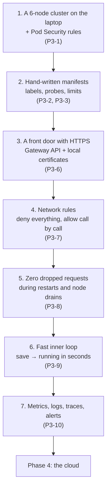

# Phase 3 explained simply

A plain-English walk through [Phase 3: Local Kubernetes](../template/03-local-kubernetes.md).
Read it before you start the phase. Then test yourself with the
[Phase 3 interview cases](p3-local-kubernetes.md).

Examples use the **Podinfo** run (fork
[`nazmur96/podinfo`](https://github.com/nazmur96/podinfo), a small Go app).
Lines marked **"In the Podinfo run"** are what actually happened, with the
measured numbers and the mistakes we hit.

Sections 4, 5 and 7 (network rules, zero-downtime, observability) go slowly,
from zero. Those are the parts where tests most often pass for the wrong
reason.

---

## The idea in one paragraph

Phase 2 put the app in a box (an image). Phase 3 runs that box on
**Kubernetes**, but on your laptop, not in the cloud. A local cluster costs
nothing and rebuilds in three minutes, so you can break it on purpose as
often as you like: stop a node, cut the network, kill pods mid-request.
Everything you learn here (probes, shutdown, network rules, TLS, metrics)
is re-checked on AWS later, but by then you already know what "working"
looks like.

## The whole phase on one page

P3-4 (databases) and P3-5 (message broker) don't apply to Podinfo, which
has neither; they come with Retail Store. P3-7b (Cilium) and P3-11 (bare
metal) are optional, and we skipped both.

---

## 1. A cluster on the laptop

*Ticket P3-1*

### What is kind?

**kind** ("Kubernetes in Docker") runs each Kubernetes machine (a **node**)
as a Docker container. Six containers, six nodes: three **control planes**
(the brain: they store the cluster's state and decide where things run) and
three **workers** (the muscle: they run your app).

Why three brains? They vote. The cluster's memory (**etcd**) needs a
majority to agree, so with three, one can die and two still form a
majority. With two, losing one leaves no majority and the cluster freezes.

### Same version as the cloud

The node image is pinned to Kubernetes **1.36**, the same minor version as
`kubectl` and the EKS cluster we'll build in Phase 4. Different versions
mean a manifest can work here and fail there.

### Pod Security: the bouncer at the namespace door

A **namespace** is a folder for Kubernetes objects. **Pod Security
Admission (PSA)** is a bouncer on each folder's door. Label a namespace
`restricted` and the bouncer turns away any pod that wants to run as root,
keep Linux capabilities, or skip the security profile. It names the rule
that failed, so you know what to fix.

> **In the Podinfo run:** a pod running as root and a pod without
> `seccompProfile` were both rejected in `podinfo-dev`, each with the
> violation named. Every namespace we created got the label. Later (P3-9) we
> found the one we hadn't created, `default`, had **no** bouncer at all
> (section 6).

### Two drills

- **Stop a worker.** Its pods move to other workers, but not at once:
  Kubernetes waits **300 s** before deciding a silent node is dead (in case
  it's just a short network blip). Podinfo moved after **355 s**.
- **Stop one control plane.** `kubectl get nodes` still answers: two of
  three brains are still a majority.

### Getting traffic in

Your browser talks to ports 80 and 443 on the laptop. kind forwards them
into one node container, onto fixed **NodePorts** (30080 and 30443), where
the front door from section 3 will listen.

> **In the Podinfo run:** `podinfo.localhost` resolves to both the IPv6 and
> the IPv4 loopback. The forward is IPv4 only; curl tries IPv6, is refused
> at once, and falls back to IPv4. Adding an IPv6 forward *broke* it: Docker
> accepted the connection and passed it to an address the cluster doesn't
> serve, so curl never fell back.

---

## 2. Manifests by hand

*Tickets P3-2 and P3-3*

### Why by hand?

No Helm charts, no generators in this phase. A chart is a machine that
writes YAML; you can only judge its output once you've written that YAML
yourself.

### Labels: name tags on everything

Every object gets the same six labels (`name`, `instance`, `component`,
`part-of`, `managed-by`, `team`). They answer "whose is this, and what is
it?" for every tool that comes later: cost reports, dashboards, network
rules.

One rule matters a lot: a Deployment's **selector** (which pods it owns) can
never be changed after creation. So the selector uses only the two labels
that never change, `name` and `instance`.

> **In the Podinfo run:** the first label check listed the objects to check
> by hand, so any new manifest would have been skipped. The fixed script
> asks kustomize what it renders and checks all of it.

### The workload, piece by piece

| Setting | Plain words |
|---|---|
| `replicas: 2`, spread across nodes | One copy can die (or move) while the other serves |
| non-root, read-only disk, all capabilities dropped | What PSA `restricted` demands; also what Phase 2 proved the image can do |
| **readiness probe** `/readyz` | "Send me users?" If no, the pod is taken out of the rotation, not killed |
| **liveness probe** `/healthz` | "Am I stuck?" If no, Kubernetes restarts the container |
| no startup probe | Podinfo is ready in 0.1 s; slow Java apps need one (Retail Store) |
| memory limit, no CPU limit | Out of memory is fatal, so cap it; a CPU limit only slows the app down |
| `preStop: sleep 5` | Wait a moment before shutting down, so the load balancer stops sending traffic first (section 5) |
| config by **env vars**, never `args:` | `args:` replaces the image's whole command and drops flags it needs |
| the secret mounted as a **folder** | A single-file mount never sees the secret change |

**Liveness must not check the database.** If it did, a 10-second database
blip would make every pod "stuck", and Kubernetes would restart all of them
at once.

> **In the Podinfo run:** a readiness test on a *copy* of the app proved
> nothing: the real Service never selected the copy, so "not in the
> Service's list" was true either way. The fixed test gave the copy its own
> Service, and watched the endpoint flip from not-ready to ready when the
> flag was removed.

---

## 3. The front door, with HTTPS

*Ticket P3-6*

### Three parts

- **Gateway API** is the standard way to describe a front door in
  Kubernetes (the older Ingress controller, `ingress-nginx`, was retired in
  2026).
- **Envoy Gateway** is the program that *is* the door locally. On AWS it
  will be a load balancer instead; the routing rules stay the same.
- **cert-manager** issues HTTPS certificates, here from our own small
  certificate authority. Your machine trusts it per command
  (`CURL_CA_BUNDLE=…`), not system-wide.

### Platform owns the door, the app owns its route

The `Gateway` (which ports, which certificate) belongs to the platform. The
`HTTPRoute` (which paths go to podinfo) belongs to the app and lives with
its manifests.

> **In the Podinfo run:** at first the platform install script applied
> podinfo's route. On a fresh cluster that failed: the app's namespace
> didn't exist yet. Moving the route to the app fixed the order.

### An allow-list, not a catch-all

The route lists exactly the six paths the user journey needs, matched
exactly. Everything else, including podinfo's dangerous endpoints, gets a
`404` from the door itself and never reaches the app.

### The renewal drill

Certificates expire, so cert-manager renews them before they do. To watch
it happen, you shorten the certificate's lifetime.

> **In the Podinfo run:** changing the lifetime on the Gateway did nothing
> to the existing certificate: cert-manager reads it only when it
> *creates* the certificate. Deleting just the secret reissued it once and
> proved nothing about renewal. What worked: annotate, delete the
> certificate **and** its secret, then watch its revision count climb by
> itself every minute.

---

## 4. Network rules, slowly

*Ticket P3-7*

### What problem does it solve?

By default, every pod in a Kubernetes cluster can talk to every other pod.
If one is broken into, the attacker can reach the rest, the database
included. A **NetworkPolicy** is a firewall rule for pods, written as YAML.

### Deny everything, then allow call by call

Think of an office building. First you lock every door (**default-deny**).
Then you hand out keys, one per real need:

1. **DNS** for everyone. Without it, nothing can even look up a name.
2. **The front door may call podinfo**, on podinfo's port only.
3. Nothing else. Podinfo calls nobody, so it gets no other outbound key.

Rules pick pods by **labels**, like keys cut for "anyone wearing a red
badge". That's powerful and dangerous: a typo means the key opens nothing
(or, written loosely, opens too much).

### First: are the locks even real?

Some network plugins ignore NetworkPolicy completely. The YAML is accepted,
nothing is enforced, and everything looks fine. So the first test is:
apply only default-deny, and a request that worked a minute ago must now
**fail**.

### The trap: a test that can't fail

> **In the Podinfo run:** the obvious test pod sat inside the same locked
> namespace. Default-deny locks **outgoing** traffic too, so the test pod
> couldn't send anything at all. "Podinfo is unreachable" passed, but it
> would have passed even if podinfo let everyone in.

It's like testing a door lock while standing inside a locked cupboard: of
course you can't get to the door. The fixed test opens the test pod's own
outbound traffic first (and checks that worked) before asking whether
podinfo lets it in.

### The second trap: a key that's too big

The front-door rule says "pods **with this label**, **in that namespace**".
Written one way, that's one condition. Written slightly differently (two
list items instead of one), it means "**any** pod in that namespace, **or**
pods with this label here". Every test still passed.

> **In the Podinfo run:** the only test that caught it was a plain pod
> placed *in the front door's own namespace*, the pod the loose rule would
> wrongly let in. `scripts/check-netpol.sh` now has that check, and we
> broke each rule on purpose (delete it, misspell a label, split it) to
> watch the script fail.

**Result:** kindnet (kind's network plugin) does enforce NetworkPolicy, and
the user journey passes with all rules on.

---

## 5. Zero dropped requests, slowly

*Ticket P3-8. The exit gate of the phase.*

### What problem does it solve?

Deploying a new version means replacing pods. Maintenance means emptying
nodes (**drain**). Both happen often, and users shouldn't notice either.

### Why requests get dropped

When Kubernetes stops a pod, two things happen *at the same time*:

1. it tells the pod to shut down;
2. it tells the load balancer to stop sending it traffic.

The second message can arrive late. If the pod is already gone, the
requests that still arrive hit a closed door. The fix is to **wait a bit
before shutting down**: `preStop: sleep 5`, then podinfo's own 3-second
drain, then up to 5 seconds to finish open requests. Total worst case 13 s,
well inside the 30 s Kubernetes allows.

### The drill

A loop sends requests through the front door non-stop, while a restart or a
drain runs, then counts the answers. Only `200`s may appear.

### How do we know the drill can fail?

A drill that always says "all fine" is worthless. So we made it fail on
purpose first:

| Setup | Failed requests per restart |
|---|---|
| no `preStop`, debug logging (which skips podinfo's own drain) | 7 and 8 |
| no `preStop` | 4, then 0 (luck) |
| `preStop: 5 s` | **0 in 8 runs** |

### The front door is a pod too

> **In the Podinfo run:** restarts were clean, but the first drains dropped
> 14-20 requests each, with both podinfo copies healthy on other nodes. The
> front door (Envoy) ran **one** copy by default, and it lived on the node
> being drained. Two copies on different nodes, plus a rule that only one
> may be taken down at a time (a **PDB**), fixed it: 0 failures across 6
> drains.

### A drill that lied

> One drain was refused by Kubernetes (a leftover test pod was in the
> way), so nothing moved, and the loop happily counted all `200`s. The
> script now fails when the drain itself fails: "the tally proves nothing".

### From scratch

Delete the cluster, build it again, install the front door, deploy, run the
journey: **3 minutes, no manual step.** That's the real test that
everything is written down.

---

## 6. A fast inner loop

*Ticket P3-9*

### What problem does it solve?

Build image → load into cluster → deploy → test takes minutes by hand. When
you're changing code, you want seconds.

### Tilt

**Tilt** watches your files. Save a Go file, and it rebuilds the image,
loads it into kind and rolls it out, using the same Dockerfile and manifests
as the deploy script.

> **In the Podinfo run:** save → new version answering through the front
> door in **8-10 seconds**. Gotcha: on its first run Tilt cleaned up the
> laptop's whole Docker build cache (660 MB, other projects' too). That's
> now switched off in the `Tiltfile`.

### mirrord: your laptop pretends to be a pod

**mirrord** runs the app on your laptop (with a debugger, if you like), but
plugs it into the cluster: it gets a real pod's environment variables, its
secret files, and a share of its traffic.

To do that, mirrord starts a helper (an **agent**) inside the cluster with
**root-level powers**. That's exactly what the PSA bouncer is meant to stop.

> **In the Podinfo run:**
> 1. The agent quietly ran in the `default` namespace, which had no bouncer
>    at all. We labelled `default` `restricted`, and gave mirrord its own
>    namespace, the **one** recorded exception (ADR-0012).
> 2. With Go, mirrord silently did nothing: no traffic, no error. It plugs
>    in through a mechanism (`LD_PRELOAD`) that a fully self-contained Go
>    binary ignores. Building a normal, dynamically linked binary fixed it.
> 3. Proof that it really worked: a login token made by a cluster pod was
>    accepted by the laptop copy (same secret), and about half the front
>    door's answers came from the laptop build.

---

## 7. Metrics, logs, traces and alerts, slowly

*Ticket P3-10. Demo-grade on purpose: one copy of everything, 24 hours of
data.*

### Three kinds of evidence

Think of investigating a car problem:

- **Metrics** are the dashboard gauges: numbers over time (requests per
  second, error rate, how slow). Tool: **Prometheus**.
- **Logs** are the mechanic's notes: one line per event. Tool: **Loki**,
  fed by **Alloy**.
- **Traces** are a dashcam of one single trip: every step one request took,
  and how long each took. Tool: **Tempo**.

**Grafana** shows all three, and links them: from a slow trace, jump to its
log lines.

### Same rules as everything else

The observability namespace gets the PSA bouncer too. Two common parts need
root-level access to the nodes: node-exporter (node health) and log
collectors that read log files from the node's disk. We turned off the
first and made Alloy read logs **through the Kubernetes API** instead.
Result: no exceptions.

> **In the Podinfo run:** the Tempo chart we expected was deprecated and
> had moved; and the stack's Grafana comes with a famous default password,
> which we replaced with a generated one.

### RED: the three numbers per service

**R**ate (requests per second), **E**rrors (share that failed), **D**uration
(how slow: we look at the **p95**, the time 95 % of requests beat). The
dashboard shows those three.

### The SLO and its alarm

An **SLO** (service level objective) is a promise: "99.5 % of user requests
succeed". The other 0.5 % is the **error budget**, what we're allowed to
spend on failures over a month.

A **burn-rate alert** fires when we spend that budget too fast: say, at 14
times the allowed speed, which would empty a month's budget in two days. It
checks a long window (1 hour, so it's real) *and* a short one (5 minutes, so
it's still happening).

The health-check paths are left out of the count: Kubernetes calls them
every few seconds, and they'd pad the "good" side.

### The drills

> **In the Podinfo run:**
> - **Latency:** a startup flag added 0.5-1 s per request. Prometheus showed
>   p95 = 0.95 s for `/version`; Tempo found the slow traces (537-732 ms);
>   one trace's ID led to its log line.
> - **Errors:** a flag failed a third of requests. The error ratio hit 11 %,
>   the alert fired after **226 s**, and it reached our stand-in pager.

### Where is the trace ID?

To jump from a trace to its logs, the logs must contain the trace's ID.

> **In the Podinfo run:** the normal logs didn't have it; only debug logs
> did, and debug mode also switches off podinfo's graceful shutdown. The
> logs podinfo sends straight to the collector (OTLP) did have it. Also,
> Tempo shows IDs without leading zeros, so we match by "contains", not
> "equals".

---

## How you know Phase 3 is done

From a **clean cluster**, built from scratch:

1. The user journey passes over HTTPS, through the front door.
2. Restarts and drains of every worker drop **zero** requests.
3. All network-rule checks pass, including the ones designed to catch
   loose rules.
4. Every namespace of ours runs PSA `restricted`; the only exception is
   mirrord's, written down in an ADR.

**In the Podinfo run** all four passed (189 s to rebuild), and the
observability stack installed from scratch on top (282 s).

## Common mistakes

| Mistake | Why it hurts |
|---|---|
| Never proving the network plugin enforces the rules | YAML accepted, nothing blocked, everyone feels safe |
| Testing a deny from inside the locked namespace | The test pod blocks itself; the test can't fail |
| Testing the app's shutdown but not the front door's | One proxy copy, one drain, every request lost |
| Trusting a drill that has never failed | It may not be able to see a failure |
| Undoing a drill by re-applying the YAML | `kubectl apply` keeps fields it never set; remove them explicitly |
| Leaving `default` without PSA labels | Privileged tools land there silently |
| Linking traces to logs without checking the logs | The ID isn't there, or isn't in the same form |
| Platform script applying app routes | Breaks the from-scratch order |

## What to remember

| File or tool | Its job |
|---|---|
| `kind/cluster.yaml`, `scripts/cluster-up.sh` | The cluster, in one command |
| `k8s/base`, `k8s/overlays/dev` | The app, by hand, labelled |
| Gateway + `HTTPRoute` | One front door, an exact allow-list, HTTPS |
| `scripts/check-netpol.sh` | Proves each network rule both ways |
| `scripts/rollout-drill.sh` | Proves restarts and drains drop nothing |
| `Tiltfile`, `scripts/mirrord.sh` | Code → cluster in seconds; debug locally with real traffic |
| `scripts/install-observability.sh` | Metrics, logs, traces and an SLO alert |

**The big idea: break it on purpose, and make sure the test can fail.**
Every check in this phase was first shown failing, because a check that
can't fail proves nothing.

**Next:** practise with the [Phase 3 interview cases](p3-local-kubernetes.md),
then [Phase 4: cloud foundation](../template/04-cloud-foundation.md).
